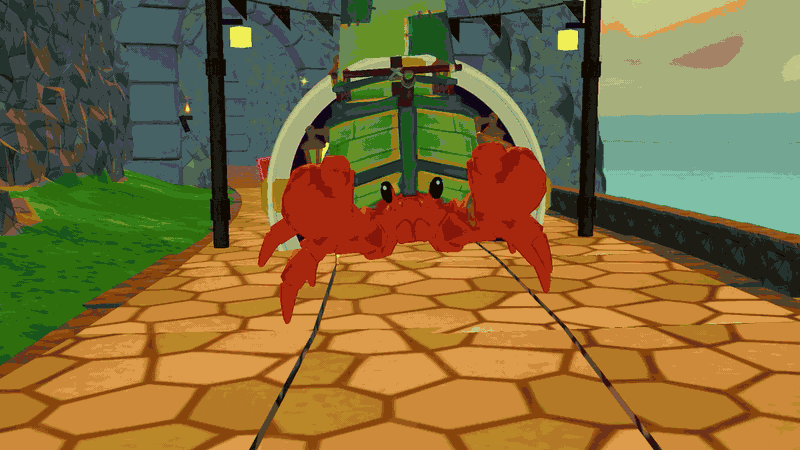
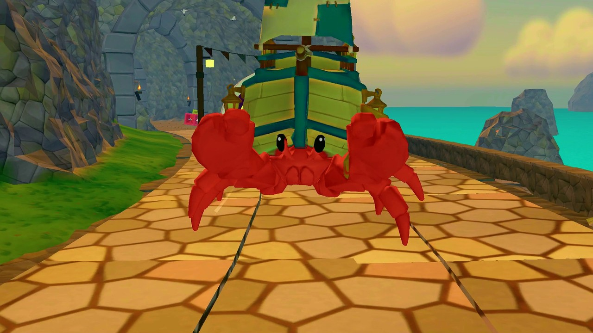
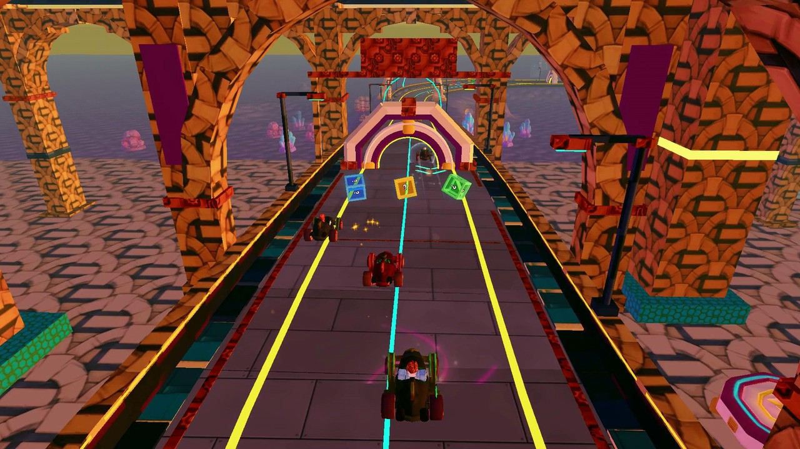
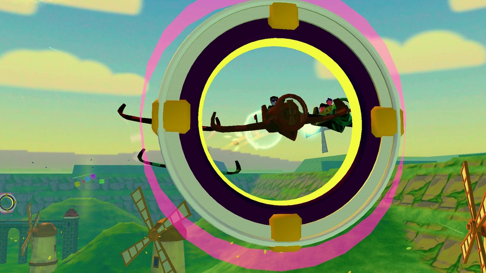

# SkyRally by Waku Worldwide



[Release v1.0: 18-second cut and 45-second master](https://github.com/retrospec13/skyrally-public/releases/tag/v1.0)

SkyRally is a Roblox kart and plane racing game with 7 map definitions, 5 bosses with rigs and animations, about 260 models, and the full Luau source. It is free to use, with MIT code and CC BY 4.0 art.

## What you can use

- Bosses with rigs and animations.
- Maps and editable source plans.
- Vehicle and race code.
- VFX.
- UI images and code.
- 19 sound effects.

<p>
<a href="media/skyrally-crab-boss.jpg"></a>
<a href="media/skyrally-snow-dogfight.jpg"></a>
<a href="media/skyrally-neon-track.jpg"></a>
<a href="media/skyrally-forest-loop-rings.jpg"></a>
</p>

## V2 source update

V2 adds Grand Prix races, a new course picker and menu system, a pause menu, race-start and slipstream effects, revised items, and map fixes. The new UI images, frame generator and 19 ElevenLabs-created sound effects are included. See [V2 changes and limits](docs/V2-UPDATE.md).

## Setup notes

The source kit below still requires Roblox setup and asset remapping.

This is still a source-and-assets kit. Import your assets and replace the hosted IDs before use. Admin and new payments stay disabled by default.

**A Rojo SOURCE project and editable asset kit, not a one-click full game.** This release includes seven map definitions (DINO-4, TESTSTRIP, HUB-0, SNOW-1, ISLAND-2, FOREST-1 and SPACE-4) and five bosses: Cinderwing, Frosthorn, Clattershell, Emberbeetle and Thunderwright. TESTSTRIP is a development track; this is not a promise of seven finished racing courses.

**Before playing:** import/upload the supplied sources under your own Roblox account or group, replace the corresponding asset IDs, then build/sync with Rojo. No packaged `.rbxl` or `.rbxlx` place is included. Existing hosted IDs are references, not a grant of access. Production admin and new payments are disabled by default.

**Large download:** the V2 source-and-assets payload is about 1.23 GB. Four retained GLBs are 62.8 to 65.0 MB each. They exceed GitHub's 50 MiB advisory but stay below its 100 MiB hard file limit; they are actual binaries, not LFS pointers. The existing public history is preserved, including earlier deleted files. This update does not shrink the normal clone download. See [layout and payload notes](docs/SOURCE-KIT-LAYOUT.md).

Start with [model source/import instructions](docs/MODEL-SOURCE-IMPORT.md) and the exact [boss roster](models/BOSS-SOURCES.json). Actual GLB geometry, rigs and embedded textures are included locally. Creator Store listings are not needed to share these sources. The optional RBXM/RBXMX and complete game still reference online Roblox assets; a Rojo build is not standalone gameplay acceptance.

## Explore

- `src/`: client/server game code and shared rules.
- `map/`: editable source plans. `docs/CONTENT.md` and `docs/guides/` explain the content.
- `build/`: generated maps, TrackData and model/terrain bakes.
- `assets/`: retained owned models, textures and VFX, plus [19 V2 sound effects](assets/audio/sfx_v37/README.md). Other recordings listed in `EXCLUDED_FILES.json` are omitted. `assets/DEPENDENCIES.json` inventories existing ID candidates; `assets/RIGHTS-INVENTORY.json` lists owned visual files under the approved art grant.
- `tools/map/` and `tools/map30/`: map authoring, validation and compiler, with provenance in `tools/map30/SOURCE.txt`.
- `tools/legacy-builders/`: retained legacy forest/snow builders. `tools/windows/`: optional keyboard-pilot helper. The root DINO-4 builder remains an authoring fixture; see the layout notes.
- `tools/tests/`: offline Luau/Python tests. Optional Studio bridge helpers have no personal targets and are disabled until explicitly configured.

## Configure locally

Default production administrator: **disabled**. Default commerce: **disabled**. No credentials are included.

Copy `config.example.json` to an untracked local file, edit it, then run:

```sh
python3 tools/configure_release.py config.local.json
```

This command validates the configuration and writes the actual `AdminConfig.luau` and `MonetizationConfig.luau` modules packaged by Rojo. It is not a documentation-only template. To restore safe defaults, run it against `config.example.json`.

- `adminUserId`: zero disables production admin; a positive integer selects exactly one administrator. The Studio-only override still requires Studio and an explicit QA attribute; live clients cannot enable it.
- `commerceEnabled`: false hides the Garage and refuses new Robux prompts. True enables configured economy behavior. Products still need a match in your universe; pass IDs are configured separately in `src/shared/StorePassIds.luau`.
- `launchHide`: true hides non-launch products/features. Do not disable it unintentionally.
- `receiptRecoveryEnabled`: explicit opt-in for legacy developer-product/pass binding while sales are disabled. This binds existing catalog matches server-side without mirroring sale IDs. Existing paid receipts still use the unchanged durable/idempotent receipt path. Before migrating a live universe with outstanding purchases, enable recovery, preserve the catalog, and validate its bindings. Do not deploy the unconfigured template as a live commerce migration.

Configuration is a build-time source change. Keep real identifiers/configuration private as appropriate, and restore defaults before redistributing a reusable template. It never uploads, grants, creates products or publishes a place.

## Local validation

Install Python with pytest, pytest-subtests, NumPy and Pillow, plus Lune and Rojo on PATH. See the [validation compatibility note](docs/SOURCE-KIT-LAYOUT.md#validation-compatibility) for the known Lune 0.10.5 baseline failure:

```sh
python3 -m pytest -q -p no:cacheprovider tools
bash tools/tests/run_lune_tests.sh
rojo build default.project.json -o /path/outside/repository/skyrally.rbxlx
```

Rebuild a map's derived code after changing its plan:

```sh
python3 tools/map/adapt.py map/forest1/plan.json
```

Headless tests and Rojo packaging are not Studio gameplay, permission or visual acceptance. With Lune 0.10.5 on the review host, the model-bake spec fails on both the old public tree and V2 with the same SurfaceAppearance/TexturePack findings. V2 does not change those bakes. Do not treat this as an all-green Lune result or proof of recipient access. Check actual rendered materials and non-owner reuse separately.

Recovered boss animation sources for Cinderwing, Clattershell, Emberbeetle and Thunderwright match the shipped clip modules. **Frosthorn's shipped Luau clip module is the authoritative editable source**; its functional animation data is preserved. The recovered animation GLB differs on six attack wing channels and is not represented as a matching export. A historical Blender/GLB round-trip is not required for Luau editing or runtime playback. See `docs/FROSTHORN-ANIMATION.md` for editing and validation, and `assets/RECOVERED-BOSS-SOURCES.json` for source status.

## Models and licensing

Owned project code is MIT. Owned art/models and the 19 included V2 ElevenLabs sound effects are CC BY 4.0, credited **Waku Worldwide**. Read `LICENSING.md` for exact scope, attribution and named third-party exclusions. Existing font, compiler and SoundFont notices remain separate. A model being present here or available from Roblox does not establish standalone redistribution rights.

The 3D model work used Tripo and hosted Hunyuan tools, plus project editing and rigging.

GLBs remain in their existing folders to preserve references and avoid duplicating the asset tree. They are ordinary tracked binary files, not LFS pointers. No individual payload file exceeds GitHub's 100 MiB limit. The repository contains browsable source and assets; no separately hosted ZIP is promised here. Nested boss `anim/out/` sources are not ignored. Removed rejected revisions are enumerated in `EXCLUDED_FILES.json`; retained model and rights manifests describe only present files. See `docs/MODEL-SOURCE-IMPORT.md` for import, preview and remapping instructions.

Public Waku Worldwide association and existing asset identity are intentional. IDs are retained as online dependency references; recipients may import local sources under their own creator and remap across plans, generated builders, serialized bakes, materials, animation, UI, sky and audio. No uploads, permission grants or publication were performed. Runtime permissions must be checked in a separate Studio experience and from an account without the original uploader's privileges.
